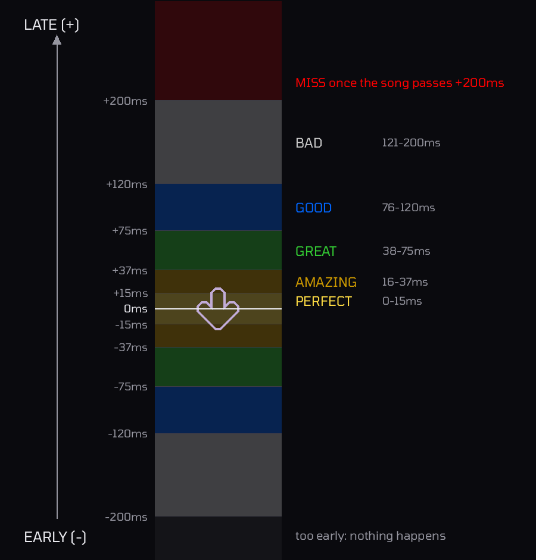
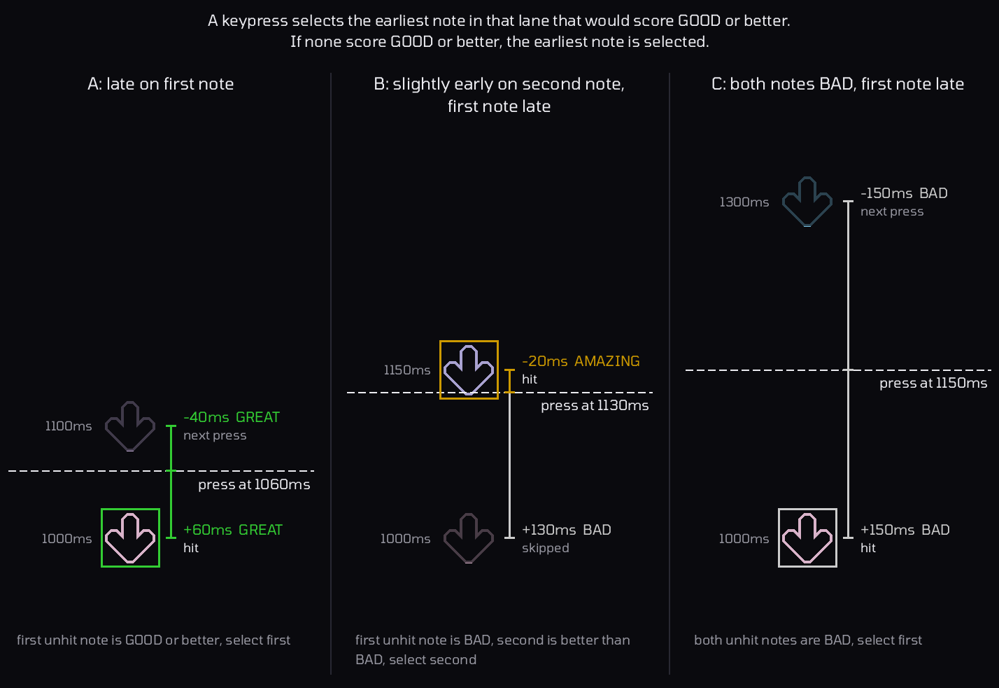
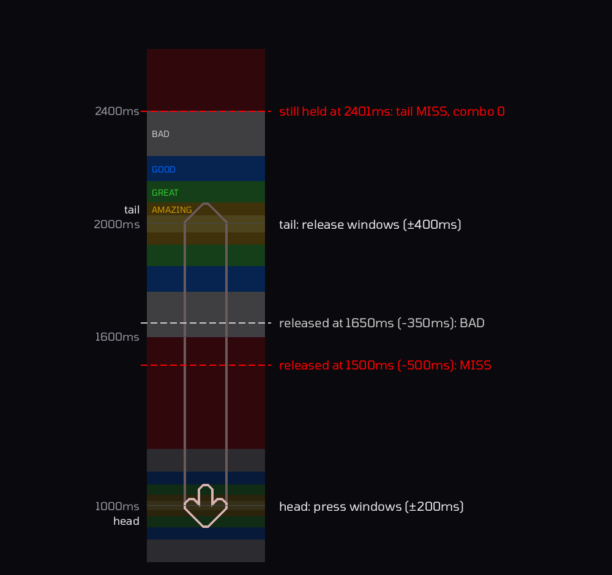
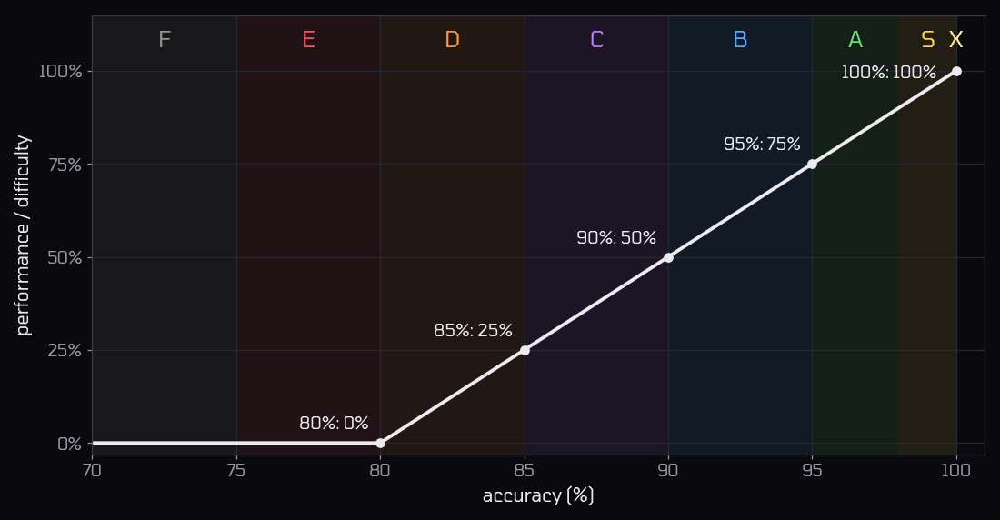
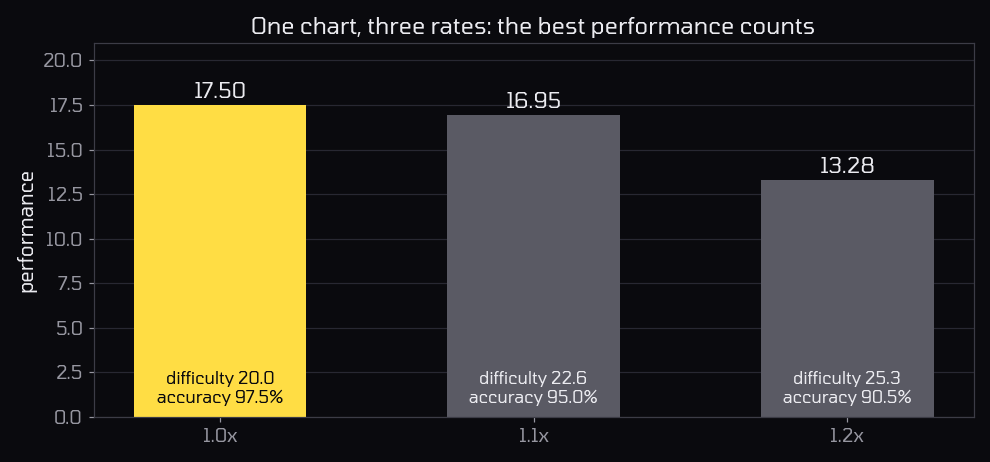
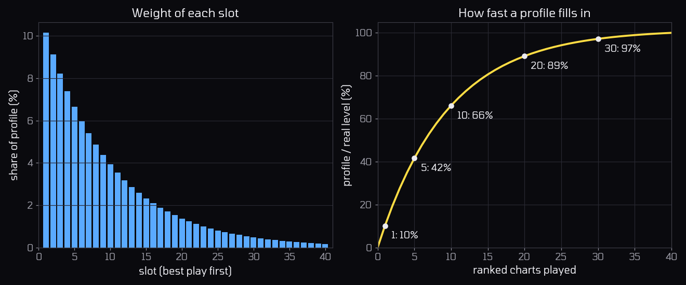

# Nascent Engine

## Contents

- [Judgement](#judgement)
  - [Timing error](#timing-error)
  - [Windows](#windows)
  - [Tap Notes](#tap-notes)
  - [Which note a keypress selects](#which-note-a-keypress-selects)
  - [Long Notes](#long-notes)
  - [Things that are never judged](#things-that-are-never-judged)
- [Accuracy](#accuracy)
  - [Combo](#combo)
  - [Average error](#average-error)
  - [Grades](#grades)
- [Performance](#performance)
  - [Play performance](#play-performance)
- [Profile performance](#profile-performance)
  - [Best play per chart](#best-play-per-chart)
  - [Weights](#weights)
  - [Profile accuracy](#profile-accuracy)

## Judgement

Every press and release is compared with the chart and given one of six judgements.

### Timing error

Every judgement compares an input time with a note time, both in whole milliseconds of song time:

```
error = input time - note time
```

- A negative error is early and a positive one is late.
- A head is judged against the note's `time`, a hold's release against its `end_time`.
- At a different rate, the chart's note times are divided by the rate, so the judgement windows stay the same size in milliseconds. They are not stretched or squeezed with the music.

### Windows

The windows are inclusive, so an error exactly on a boundary gets the better judgement. Releases get twice the window size of presses.

| Judgement | Press window | Release window | Accuracy value |
|---|---|---|---|
| PERFECT | ±15 ms | ±30 ms | 100% |
| AMAZING | ±37 ms | ±74 ms | 95% |
| GREAT | ±75 ms | ±150 ms | 70% |
| GOOD | ±120 ms | ±240 ms | 40% |
| BAD | ±200 ms | ±400 ms | 10% |
| MISS | outside BAD | outside BAD | 0% |



The windows come from base windows of `10ms`, `25ms`, `50ms`, `80ms` and `160ms` ms. They are scaled to `base * (20 − strictness) / 10` with integer division, then capped at `200ms`, then doubled for releases. Ranked gameplay always uses `strictness = 5`.

### Tap Notes

- A press more than 200 ms early isn't judged and doesn't mark the note as hit. There's no penalty for it.
- A note becomes MISS as soon as the song time passes `note + 200` if it hasn't been hit.
- Releasing timing for a tap note isn't judged. Taps notes only have a press judgement.

### Which note a keypress selects

A press only looks at its own lane and only at notes that haven't been judged yet, in chart order. Of those within ±200 ms:

1. It takes the **earliest note it would score GOOD or better on**.
2. If every note in reach would be BAD, it takes the **earliest** of them.

This is to prevent certain column locking scenarios where you would chain bads by missing a single note in a longjack.



### Long Notes

A long note is worth **two judgements**: its head, judged like a normal note press, and its tail, judged by the release against `end_time` using the double size release windows. Both count toward accuracy and combo.



**Holding too long.** If the key is still held at `end_time + 400`, the tail becomes a MISS, and the combo breaks.

**No long note regrabbing.** Once a long note's key is released, the tail is judged for good. Pressing the lane again before `end_time` doesn't reconnect to the hold. The new press looks for the next note instead.

**Head missed.** If the head passes its window without a press, the head and tail are both MISS immediately, and the long note can never be pressed.

### Things that are never judged

- **Holding a key through a note.** Only keypresses hit notes. A key that's already down when a note arrives won't hit it, so that note will be missed.
- **Ghost taps.** A press with no note in reach, or a release with no hold attached, does nothing. There's no penalty for mashing or for tapping to the beat between notes.
- **Repeated events.** A press for a key that's already held, or a release for one that isn't, is ignored.

## Accuracy

Each judgement is worth a fixed accuracy value, and a play's accuracy is the average value of every judgement so far:

```
accuracy = Σ{ value(judgement) / (num_judgements * 100%) }
```

| PERFECT | AMAZING | GREAT | GOOD | BAD | MISS |
|---|---|---|---|---|---|
| 100% | 95% | 70% | 40% | 10% | 0% |

Each note is one judgement and each long note is two: one for each its head and release.

### Combo

Combo goes up by one for every judgement that isn't a MISS, so a hold can add two. Only a MISS resets it to zero, whether that's a missed head, an early release, or a long note held too long. Combo is fully cosmetic and not used in calculating ranking, performance, or accuracy.

### Average error

Average error is the mean signed error of the heads that were pressed, where negative means early. Releases and misses don't count, so it reflects press timing only.

### Grades

The grade comes from accuracy alone:

| Grade | X | S | A | B | C | D | E | F |
|---|---|---|---|---|---|---|---|---|
| accuracy | 100% | ≥ 98% | ≥ 95% | ≥ 90% | ≥ 85% | ≥ 80% | ≥ 75% | below 75% |

## Performance

Performance measures how impressive a play is. It combines how difficult the chart is at the rate played with how accurately it was played.

### Play performance

A play's performance grows linearly with accuracy above 80%:

```
performance = difficulty * max(accuracy − 0.80, 0) / 0.20
```



| Accuracy | ≤ 80% | 85% | 90% | 95% | 98% | 100% |
|---|---|---|---|---|---|---|
| share of difficulty | 0% | 25% | 50% | 75% | 90% | 100% |

At 100%, a play is worth the chart's full difficulty at that rate in performance. An E grade or lower earns nothing.

## Profile performance

A player has a separate profile performance for each key count from 4K to 10K. Each one is a weighted average of the player's best ranked plays on their top 40 charts in that key count:

```
perf_profile = Σ{0.9^i * perf_i} / Σ{0.9^i}    for i = 0..39
```

`perf_0` is their best play, `perf_1` the next best and so on. Missing slots count as 0, but the bottom of the fraction always covers all 40 slots.

### Best play per chart

Each chart fills one slot at most, with whichever play on it is worth the most, at any rate:



### Weights

Slot `i` has weight 0.9^i, so the best play counts most and each slot afterwards counts 10% less than the one above it:




- **One good play can't carry a profile:** A single play only counts for ~10% of its value at best.
- **Profile performance settles quickly:** The top 10 slots carry about two thirds of the weight.
- **A new play never lowers performance:** It either fills an empty slot or pushes weaker plays down a slot, and every slot it touches ends up holding a play at least as good as before.

### Profile accuracy

Profile accuracy uses the same weights over the same plays, in the same order, with best performance first. It divides only by the weight of the slots that are filled, so empty slots don't drag it down.
